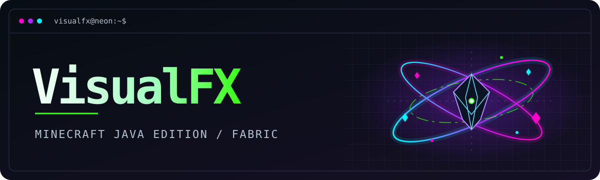

  
  <h1>VisualFX</h1>
  
Неоновые эффекты вокруг игрока под прицелом и настраиваемый HUD для Minecraft Java Edition.

  
<a href="https://github.com/xfoloder/VisualFX/releases/download/v1.19.0-mc26.3/visualfx-1.19.0-mc26.3.jar"><strong>Скачать JAR для Minecraft 26.3</strong></a> · <a href="https://github.com/xfoloder/VisualFX/releases/download/v1.19.0-mc1.21.11/visualfx-1.19.0-mc1.21.11.jar">JAR для 1.21.11</a> · <a href="https://github.com/xfoloder/VisualFX/releases">Все релизы</a>

## Возможности

| Раздел | Что можно настроить |
| --- | --- |
| **Visual** | 13 режимов Target ESP, TargetHUD с привязкой к цели, Neon Echo со световым следом её движения и перемещаемая панель Effect Status. Для Death Effect доступны Ascend и Exit Hell. |
| **Combat** | 6 визуальных реакций на удар, от неоновой ударной волны до рунической печати. |
| **Misc** | Watermark с FPS и пингом, пресеты оптимизации и управление SoundCloud через браузер. |

**Right Shift** открывает меню в стиле Linux-терминала. Перетаскивай окно за заголовок, меняй его масштаб и подбирай цвета в редакторе с предпросмотром. Параметры сохраняются в `config/visualfx.json`.

## Установка

| Minecraft | Скачать VisualFX 1.19.0 | Java | Fabric Loader |
| --- | --- | --- | --- |
| **26.3** | [Установочный JAR](https://github.com/xfoloder/VisualFX/releases/download/v1.19.0-mc26.3/visualfx-1.19.0-mc26.3.jar) | 25 | 0.20.1 или новее |
| **1.21.11** | [Установочный JAR](https://github.com/xfoloder/VisualFX/releases/download/v1.19.0-mc1.21.11/visualfx-1.19.0-mc1.21.11.jar) | 21 | 0.18.4 или новее |

1. Создай профиль Minecraft с [Fabric Loader](https://fabricmc.net/use/installer/).
2. Положи JAR VisualFX и [Fabric API](https://modrinth.com/mod/fabric-api/versions) для этой же версии Minecraft в папку `mods` профиля. При обновлении убери оттуда старый JAR VisualFX.
3. Запусти профиль и нажми **Right Shift**. Для работы в мультиплеере достаточно установить мод на клиент.

## Сборка из исходников

Для Minecraft 26.3 используй ветку `main` и JDK 25. Для Minecraft 1.21.11 переключись на [ветку `mc1.21.11`](https://github.com/xfoloder/VisualFX/tree/mc1.21.11) и используй JDK 21.

На Windows запусти `./gradlew.bat build`, на Linux или macOS — `./gradlew build`. Установочный JAR появится в `build/libs/`.

[Полное руководство и история изменений](README_RU.md) · [Результаты проверки сборки 26.3](VERIFICATION.md)
